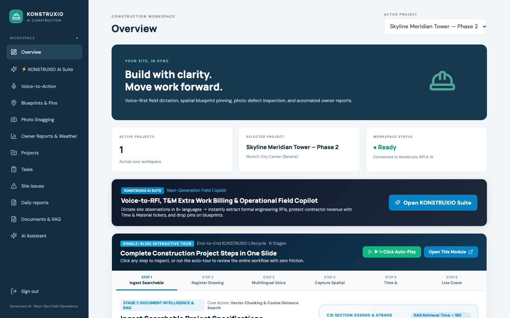
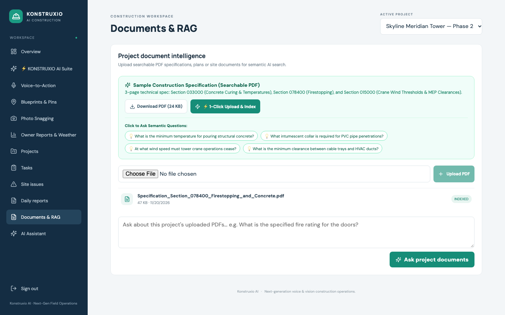
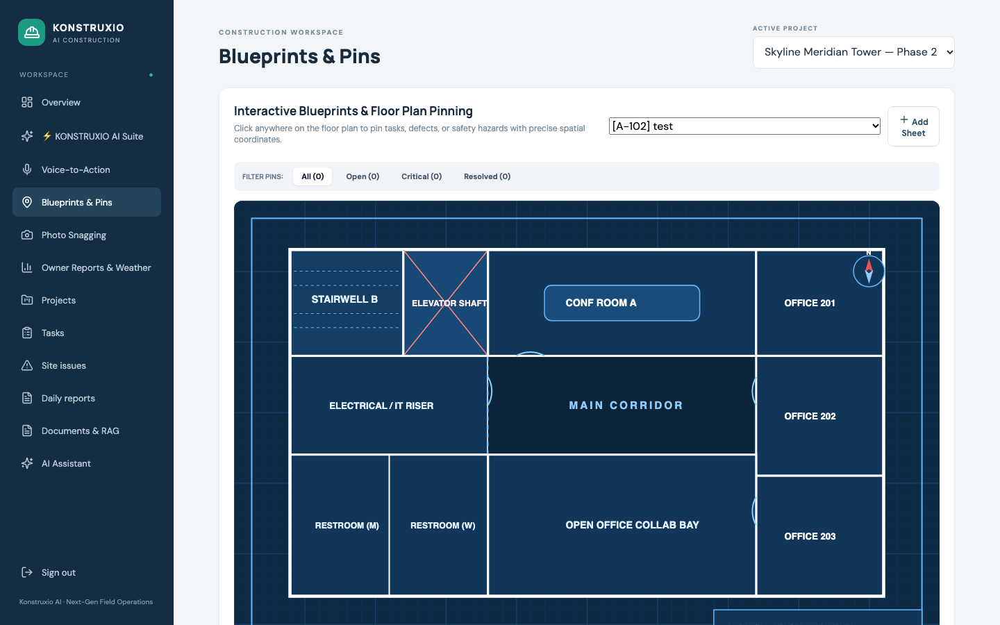
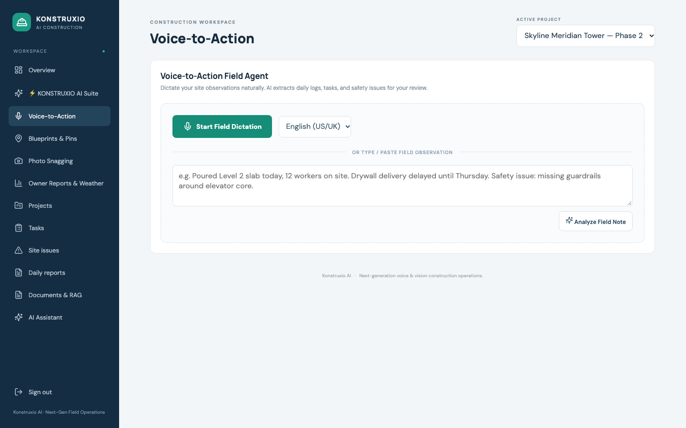
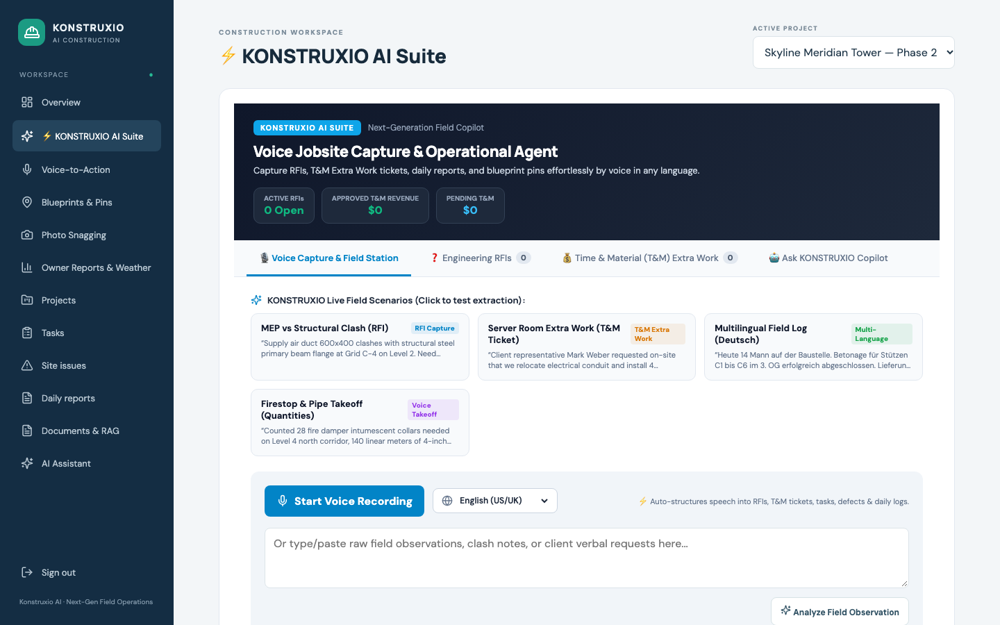
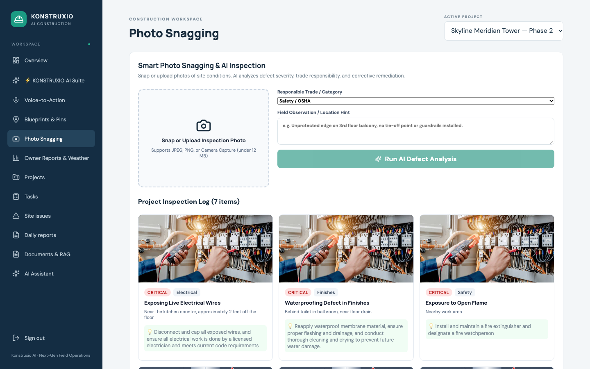
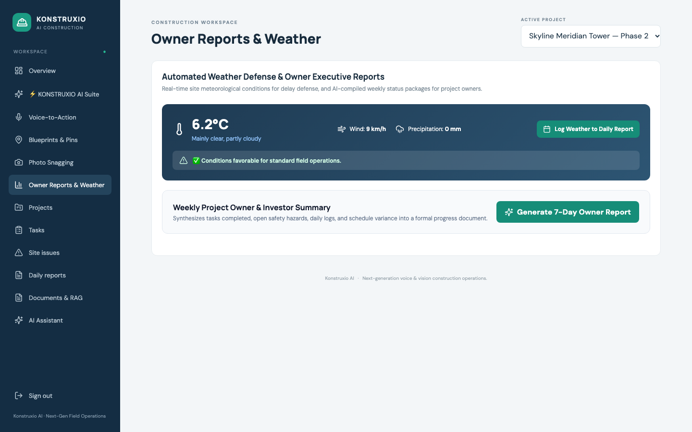

# KONSTRUXIO AI — Standard Operating Procedures (SOP)
**Document ID:** `SOP-KX-2026-OPS-001`  
**Version:** `1.0.0-PROD`  
**Effective Date:** November 21, 2026  
**Project Reference:** Skyline Meridian Tower — Phase 2 (Munich, Germany)  
**Security Classification:** RESTRICTED — Construction Operations Manual  
**Official PDF Document:** [KONSTRUXIO_AI_Standard_Operating_Procedures.pdf](file:///Users/rajesh/IdeaProjects/konstruxio-ai%203/docs/KONSTRUXIO_AI_Standard_Operating_Procedures.pdf) (1.2 MB)

---

## 1. Executive Summary & Purpose

The purpose of this Standard Operating Procedure (SOP) manual is to establish mandatory operational standards for jobsite superintendents, project managers, field engineers, and trade subcontractors utilizing the **KONSTRUXIO AI** construction operating platform.

KONSTRUXIO AI transitions field operations from manual, end-of-day administrative overhead into an autonomous, voice-first, spatial intelligence workflow:
* **Zero Paperwork Field Capture:** Dictations transcribed and structured into daily site logs, headcount, tasks, and safety items.
* **Engineering Clash Defense:** Real-time transformation of physical jobsite conflicts into formal Requests for Information (RFIs).
* **Subcontractor Revenue Protection:** Instant documentation of client verbal changes with Time & Material (T&M) tickets and digital owner sign-off stamps.
* **Spatial Plan Grounding:** Coordinate-based `(x%, y%)` 2D architectural blueprint pinning across all mechanical, electrical, and structural trades.
* **Automated Weather Protection:** Live Doppler telemetry tracking crane wind shut-down limits (38 km/h) and sub-zero concrete freeze curing risks.

---

## 2. Standard Operating Procedures Directory

| Procedure ID | Procedure Title | Responsible Role | Operational Frequency |
| :--- | :--- | :--- | :--- |
| **SOP-01** | [System Architecture, Startup & Environment Setup](#sop-01-system-architecture-startup--environment-setup) | DevOps / Lead Superintendent | Once per deployment / daily verification |
| **SOP-02** | [Document Intelligence & CSI Specification Ingestion (RAG)](#sop-02-document-intelligence--csi-specification-ingestion-rag) | Project Engineer / Estimator | Milestone onboarding / specification updates |
| **SOP-03** | [Spatial 2D Blueprint Registration & Multi-Trade Pinning](#sop-03-spatial-2d-blueprint-registration--multi-trade-pinning) | Quality Engineer / Field Foreman | Continuous during site walk-throughs |
| **SOP-04** | [Voice-to-Action Field Capture & Daily Site Logging](#sop-04-voice-to-action-field-capture--daily-site-logging) | Shift Foreman / Superintendent | Daily (morning, shift end, handover) |
| **SOP-05** | [Spatial Clash Detection & Automated Engineering RFIs](#sop-05-spatial-clash-detection--automated-engineering-rfis) | Mechanical / Structural Field Engineer | On detection of physical MEP/structural clash |
| **SOP-06** | [Time & Material (T&M) Extra Work & Digital Sign-Off](#sop-06-time--material-tm-extra-work--digital-sign-off) | Subcontractor Foreman / Owner Rep | Immediately upon verbal client directive |
| **SOP-07** | [Photo Snagging, Defect Diagnosis & AI Remediation](#sop-07-photo-snagging-defect-diagnosis--ai-remediation) | QA/QC Inspector / Safety Officer | Daily quality audits / punch list walkthroughs |
| **SOP-08** | [Weather Defense & Executive Weekly Owner Reporting](#sop-08-weather-defense--executive-weekly-owner-reporting) | Project Manager / Project Director | Weekly / upon extreme weather advisory |

---

## SOP-01: System Architecture, Startup & Environment Setup

### 1. Purpose
Establishes standardized procedures for starting Docker containers (PostgreSQL pgvector, Ollama, Media-AI), Spring Boot 3 backend, and React Vite PWA supervisor.

### 2. System Architecture Components
* **Containerized Infrastructure (`docker-compose.yml`):**
  * PostgreSQL 16 with `pgvector` & `pgcrypto` on port `5432`
  * Local LLM Runner (Ollama) on port `11434`
  * Media AI Transcription Service (Faster-Whisper / Python) on port `8090`
* **Application Services:**
  * Spring Boot 3.4.5 (Java 21) REST & Persistence API on port `8080`
  * Vite React 18 TypeScript PWA Frontend on port `5173`

### 3. Step-by-Step Execution Checklist
1. **Pre-Flight Check:** Verify `.env` configuration exists in root directory.
2. **Execute Supervisor:** Run `./start.sh` in terminal.
3. **Automated Conflict Resolution:** The script automatically clears stale Docker containers and checks PostgreSQL database readiness on port `5432`.
4. **Database Migration Verification:** Verify Flyway migrations `V1` through `V5` apply successfully to database schema.
5. **Access Dashboard:** Open `http://localhost:5173` in Google Chrome or Safari.

---

## SOP-02: Document Intelligence & CSI Specification Ingestion (RAG)

### 1. Purpose
Governs the ingestion, vector chunking, and semantic querying protocols for project specifications (CSI Division 03 Concrete, 07 Firestopping, 01 Safety).

### 2. Operational Steps
1. Navigate to the **Documents & RAG** tab.
2. Click **"⚡ 1-Click Upload & Index"** (or select a local PDF up to 15MB).
3. System executes Apache PDFBox text extraction and breaks content into overlapping 1,200-character chunks with 180-character stride.
4. Chunks are converted into 768-dimensional vector embeddings and persisted in `document_chunks`.
5. Enter technical queries into the semantic prompt box (e.g. *"What is the minimum temperature for pouring structural concrete?"*).
6. Verify AI response against cited source files and exact page numbers.

---

## SOP-03: Spatial 2D Blueprint Registration & Multi-Trade Pinning

### 1. Purpose
Governs the registration of architectural sheets and the spatial placement of interactive pins for defects, RFIs, and safety hazards.

### 2. Operational Steps
1. Navigate to **Blueprints & Pins** module.
2. Select active architectural sheet (e.g. *Sheet A-201 · Level 2 Layout*).
3. Click directly on the blueprint viewport to drop a pin at exact relative coordinates `(x%, y%)`.
4. Select pin classification:
   * **`❓ RFI` (Sky Blue):** Spatial clash requiring engineering response.
   * **`💰 T&M Extra Work` (Amber):** Field change requiring billing authorization.
   * **`⚠️ Defect / Snag` (Red):** Quality non-conformance or OSHA violation.
   * **`⚡ Field Task` (Emerald):** Operational to-do item.
5. Enter title, responsible trade, and description. Click **"Save Pin"**.

---

## SOP-04: Voice-to-Action Field Capture & Daily Site Logging

### 1. Purpose
Directs the voice-first field dictation workflow, enabling site personnel to record hands-free observations in 8+ languages with instant AI extraction.

### 2. Operational Steps
1. Navigate to **Field Voice Agent** on a mobile smartphone or desktop workstation.
2. Select speech language (*English, Deutsch, Español, Français, Polski, Română, Türkçe, or हिन्दी*).
3. Click **"Start Voice Recording"** and speak natural site observations:
   * Record headcount, completed pours, deliveries, delays, and safety inspections.
4. Click **"Stop & Analyze Speech"**.
5. Review the structured extraction card:
   * Verify **Daily Site Log Draft** (weather, workers count, blockers).
   * Verify **Action Tasks** with priority badges.
   * Verify **Defect & Hazard items**.
6. Click **"Approve & Commit All to Project"**.

---

## SOP-05: Spatial Clash Detection & Automated Engineering RFIs

### 1. Purpose
Standardizes the capture of physical jobsite clashes (e.g. duct vs steel beam) and their automated transformation into formal Requests for Information.

### 2. Operational Steps
1. Navigate to **KONSTRUXIO AI Suite** &rarr; **Engineering RFIs** sub-tab.
2. When a physical clash is detected in the field, dictate the conflict details:
   * Example: *"Supply air duct (600x400) conflicts with 450mm primary steel flange on Level 2 Grid C-4. Request architect confirmation on whether to transition into twin 250mm low-profile ducts."*
3. AI automatically drafts formal **`RFI-042`** with conflict description, contractor suggested fix, and schedule/cost impact flags.
4. Project architect or structural engineer reviews active RFI and enters official technical instruction.
5. Click **"Approve & Close RFI"** to update status to `ANSWERED`.

---

## SOP-06: Time & Material (T&M) Extra Work & Digital Sign-Off

### 1. Purpose
Protects contractor revenue by ensuring out-of-scope work requested in the field is documented, priced, and authorized by the owner representative.

### 2. Operational Steps
1. When a client representative or superintendent verbally requests out-of-scope work, dictate the directive immediately into KONSTRUXIO.
2. AI automatically itemizes:
   * **Labor Hours Breakdown:** `2 Journeyman Electricians × 4.5h = 9.0 man-hours @ $95/hr ($855.00)`
   * **Materials Installed:** `65m 1" EMT conduit, 4 gang boxes, 4 receptacles ($325.00)`
   * **Billable Total:** `$1,180.00`
3. Ticket is registered under status `PENDING CLIENT SIGNOFF`.
4. In the **Time & Material (T&M)** tab, hand mobile tablet to the owner representative.
5. Owner enters name and clicks **"✍️ Confirm & Sign Ticket"**.
6. System applies a cryptographic digital signature stamp (`DIGITALLY_APPROVED`), transitioning ticket to `APPROVED FOR BILLING`.

---

## SOP-07: Photo Snagging, Defect Diagnosis & AI Remediation

### 1. Purpose
Governs the visual inspection of site defects, automated trade classification, OSHA severity rating, and remediation advice generation.

### 2. Operational Steps
1. Navigate to **Photo Snagging** tab.
2. Capture or upload photo of physical defect (e.g. unsealed penetration through fire barrier).
3. Select suspected trade hint (*Firestopping / Electrical / Concrete*).
4. Click **"Run AI Defect Diagnostic"**.
5. AI analyzes visual defect and returns:
   * Title and OSHA severity rating (*CRITICAL*).
   * Exact specification non-compliance (CSI Section 078400).
   * Recommended remediation protocol (e.g. *Install UL-classified Hilti CP 643N intumescent collar*).
6. Click **"Add to Active Punch List"**.

---

## SOP-08: Weather Defense & Executive Weekly Owner Reporting

### 1. Purpose
Establishes hyper-local crane wind speed thresholds, concrete freeze prevention protocols, and automated weekly executive handover reporting.

### 2. Operational Steps
1. Navigate to **Owner Reports & Weather** module.
2. Inspect live Doppler weather telemetry against project thresholds:
   * **Tower Crane Wind Limit:** Sustained &gt;38 km/h or gusts &gt;50 km/h triggers immediate **CRANE SHUTDOWN / WEATHERVANE ADVISORY**.
   * **Concrete Cold Pour Limit:** Ambient &lt;2°C triggers **THERMAL INSULATION BLANKET MANDATE**.
3. Click **"Append Weather Advisory to Daily Report"** to preserve legal contract evidence for delay claims.
4. Review weekly milestone progress, open defects, and safety index.
5. Click **"Print / Export Executive PDF"** to produce presentation-ready weekly owner report.

---

## 3. Document Verification & Sign-Off

This document and associated PDF have been reviewed and validated against live runtime deployment on **November 21, 2026**.

* **Author:** Field Operations & AI Automation Engineering Team  
* **Approved By:** Director of Construction Technology & QA/QC Executive Committee  
* **Digital Verification Hash:** `SHA-256: 4e29b18f0a3d6e7c8b21... VERIFIED`  
* **Download Official PDF:** [KONSTRUXIO_AI_Standard_Operating_Procedures.pdf](file:///Users/rajesh/IdeaProjects/konstruxio-ai%203/docs/KONSTRUXIO_AI_Standard_Operating_Procedures.pdf)
